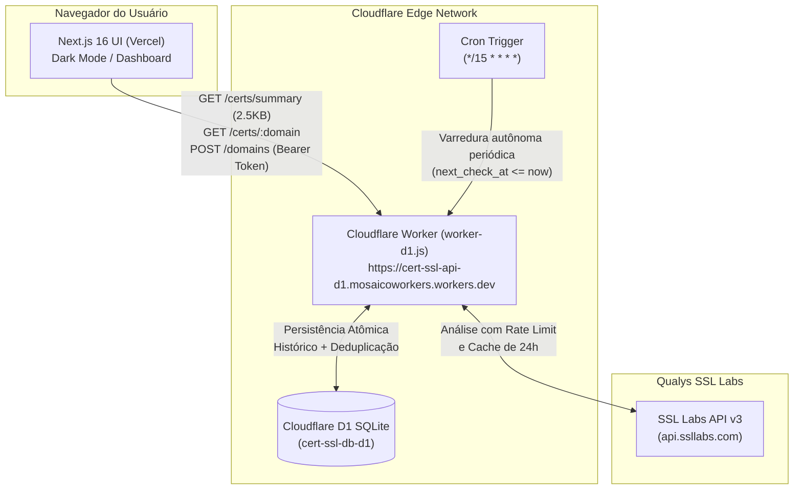

# 🛡️ CertMonitor

**Monitoramento e Auditoria Contínua de Certificados SSL/TLS**

> Aplicação em produção: [https://cert-next-seven.vercel.app/](https://cert-next-seven.vercel.app/)  
> Repositório oficial: [https://github.com/mtcporto/cert](https://github.com/mtcporto/cert)

---

## 🏛️ Visão Geral da Arquitetura

O **CertMonitor** é uma plataforma de monitoramento contínuo e análise profunda de segurança TLS/SSL para domínios corporativos e aplicações web. Utiliza a API Qualys SSL Labs v3 com cache inteligente, persistência em edge database e agendamento autônomo via Cloudflare Workers Cron Triggers.



### Principais Componentes

1. **Frontend (Next.js 16 / React 19 / Tailwind CSS v4):**
   - Hospedado na **Vercel** com CI/CD automático via GitHub.
   - Dark mode nativo por padrão.
   - Painel de status em 5 categorias: **Válido**, **Expirando em Breve**, **Expirado**, **Inseguro** e **Em Análise / Erro**.
   - Carga ultrarrápida: consome endpoint resumido `GET /certs/summary` (~2.5 KB) e hidrata detalhes sob demanda em tela cheia ao inspecionar um domínio.
   - Banner de alertas persistente com deduplicação de eventos críticos.

2. **Backend Serverless (Cloudflare Worker):**
   - Implementado em `worker-d1.js` com TypeScript/ES modules.
   - Proteção de endpoints administrativos (`POST /domains`) via token Bearer (`ADMIN_TOKEN`).
   - Política de CORS estrita com allowlist (Vercel production, preview e localhost).
   - Rate limiting defensivo e respeito às cotas simultâneas da Qualys SSL Labs (`/info`).
   - Deduplicação de eventos de auditoria (mudança de nota, alertas de 30/14/7/1 dias para expiração, certificados inseguros).
   - Política de retenção automática: preserva no máximo 30 verificações por domínio para evitar crescimento descontrolado do banco.

3. **Banco de Dados Edge (Cloudflare D1):**
   - SQLite distribuído de latência ultrabaixa na edge.
   - Tabelas principais: `domains`, `certificate_checks` e `events`.
   - Índices compostos otimizados para consultas por domínio e tempo (`idx_cert_checks_domain_checked`, `idx_events_dedup`).

4. **Monitoramento Autônomo (Cron Trigger):**
   - Execução automática a cada 15 minutos (`*/15 * * * *`).
   - Identifica domínios agendados com `next_check_at <= now` e dispara análises em segundo plano sem necessidade de manter abas abertas no navegador.

---

## 🔒 Segurança e Classificação Rigorosa

O CertMonitor implementa regras estritas de classificação de conformidade:
- **Inseguro:** Domínios com nota final **T** (não confiável / certificado autoassinado / cadeia corrompida), **M** (incompatibilidade de nome), **F**, notas inferiores ou iguais a **C-**, ou presença de vulnerabilidades graves no servidor (ex: Heartbleed, POODLE).
- **Tratamento do BEAST:** Vulnerabilidade mitigada no lado do cliente (browsers modernos) é registrada como informativa sem penalizar indevidamente certificados íntegros.
- **Piores notas multi-endpoint:** Em domínios com múltiplos endereços IPv4/IPv6, a pior nota entre os endpoints define a classificação global.

---

## 🛠️ Desenvolvimento Local

### Pré-requisitos
- Node.js 20+ ou 24+
- npm ou pnpm
- Conta Cloudflare com Wrangler CLI autenticado (`npx wrangler login`)

### Configuração do Ambiente

1. Clone o repositório:
```bash
git clone https://github.com/mtcporto/cert.git
cd cert
```

2. Instale as dependências:
```bash
npm install
```

3. Crie o arquivo `.env.local`:
```bash
cp .env.example .env.local
```
O conteúdo deve conter:
```env
NEXT_PUBLIC_API_BASE=https://cert-ssl-api-d1.mosaicoworkers.workers.dev
NEXT_PUBLIC_APP_URL=http://localhost:3000
```

4. Execute os testes unitários (Vitest):
```bash
npm test
```

5. Inicie o servidor de desenvolvimento:
```bash
npm run dev
```
Acesse [http://localhost:3000](http://localhost:3000).

---

## 🚀 Deploy e Operações

### Deploy do Frontend (Vercel)
O deploy é **100% automatizado** via GitHub Actions / Vercel Integration:
```bash
git add .
git commit -m "feat/fix: sua mensagem clara"
git push origin main
```
*Não utilize comandos manuais como `vercel --prod` para evitar conflito com a pipeline de CI/CD.*

### Deploy do Backend (Cloudflare Worker)
Para publicar alterações no Worker:
```bash
npx wrangler deploy
```

### Gerenciamento de Secrets no Cloudflare
Definir o token de administração para operações de escrita (`POST /domains`):
```bash
npx wrangler secret put ADMIN_TOKEN
```

### Migrações no Banco D1
Para aplicar ou atualizar o schema no banco de dados D1 remoto:
```bash
npx wrangler d1 execute cert-ssl-db-d1 --remote --file=./d1-schema.sql
```

---

## 🧪 Testes Automatizados

A suíte de testes unitários baseada em **Vitest** cobre:
- Classificação correta de certificados válidos, expirando, expirados e inseguros.
- Resolução da pior nota entre múltiplos endpoints (`resolveWorstGrade`).
- Extração precisa de emitentes (Let's Encrypt, DigiCert, Sectigo, etc.).
- Detecção e desconsideração controlada de alertas informativos vs. vulnerabilidades críticas.

Execute a suíte com:
```bash
npm test
```

---

## 📄 Licença

Projeto desenvolvido sob a licença [MIT](LICENSE).
